# magus

<p align="center">
  <picture>
    <source srcset="./assets/gopher.webp" type="image/webp">
    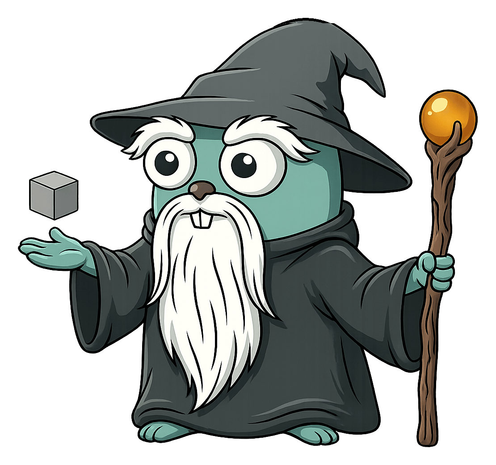
  </picture>
</p>

<!-- The coverage badges are measured by CI's coverage job on every push to main, rendered from that run's profiles by `magus run coverage-render .` in the CD site job, and published with the docs site. Nothing commits them. -->

<a href="https://github.com/egladman/magus/actions/workflows/ci.yaml?query=branch%3Amain"></a> <a href="https://github.com/egladman/magus/actions/workflows/cd.yaml?query=branch%3Amain"></a>    <a href="https://pkg.go.dev/github.com/egladman/magus"></a>

A cross-platform task orchestrator for polyglot monorepos.

Change a file and magus works out which projects it reaches, rebuilds only those, and caches every result so the same work never runs twice.

magus hands you what it knows about your repository (what a change reaches, which files are generated, where a symbol is used), and the call stays yours. You declare what each target reads and writes, and magus stops when a run disagrees.

<!-- README terminal recordings are rendered by `magus run termcast-generate` from
     tapes/core-loop.capture. Re-record that real CLI session with `magus run
     termcast-record` when its output changes; commit the capture and SVG together.
     The same tool, cmd/magus-termcast, has a second mode: `magus run
     termshots-generate` runs its `shots` subcommand, which renders the static
     interactive-view SVGs used in the documentation. -->

<p align="center">
  <picture>
    <source media="(prefers-color-scheme: light)" srcset="./assets/gen/core-loop-light.svg">
    
  </picture>
</p>

<p align="center"><em>One command, three runs: cold, fully cached, then narrowed to what a change reached.</em></p>

More: [the knowledge graph](docs/concepts/knowledge.md),
[targets](docs/concepts/targets.md), [agents](docs/guides/integrations/agents.md),
and the blog post
[I think our tools are the problem](https://eli.gladman.cc/magus/blog/2026/08/18/i-think-our-tools-are-the-problem/).

## How it works

### Affected sets

magus keeps a dependency graph of your projects and knows which files each
target reads. Change a file and `magus affected <target>` runs only the
projects that change can reach, in dependency order. `magus affected ci` runs
the full pipeline over that set, so CI does the least work a change requires
and still catches breakage in a project you never opened. See [CI](docs/concepts/targets/ci.md).

### Content-addressed caching

Every target declares its inputs and outputs. magus hashes the inputs, and if
it has already seen that hash it replays the stored output instead of running
the work again. The cache is a plain content-addressed store on disk (SHA-256):
the input hash is the key, and the stored outputs are addressed by their own
content hash, so a replay is a byte-for-byte reproduction of the recorded run.
Every run leaves an output ref that `magus query output <ref>` reopens.

### The knowledge graph

magus builds the graph from what it already reads to run the build: every
project, every target's declared inputs and outputs, and what a diff reaches.
Every edge traces to a declaration you can open.

`magus query "kind=target lint"` finds
nodes, `magus explain <node>` shows a node's edges and what reaches it, and
`magus refs <symbol>` lists where a symbol is defined and used from a SCIP
index.[^scip] The same graph answers "is this file generated," "what does my diff
touch," and "how do these two things relate" without grepping. See the
[knowledge graph](docs/concepts/knowledge.md), including
[what this graph deliberately is not](docs/concepts/knowledge.md#what-this-graph-is-not).

### One vocabulary

magus names a thing once and reuses the name everywhere, in the CLI, the config,
and the graph. A [target](docs/concepts/targets.md) is a unit of work such as build,
test, or lint. A [spell](docs/concepts/spells.md) is a language adapter that supplies a
target's operations (the `go` spell provides `go-test`; the `buf` spell provides
`buf-lint`). A [charm](docs/concepts/charms.md) is a modifier applied to a run, like `rw`
for read-write or `cd` for continuous delivery. An [op](docs/concepts/operations.md) is a
single tool invocation.

### The terminal UI

<!-- This README recording is captured by `magus run termcast-showcase` from a real
     interactive session driven by real keystrokes, then rendered by `magus run
     termcast-generate`. Commit its capture and SVG together. -->

<p align="center">
  <picture>
    <source media="(prefers-color-scheme: light)" srcset="./assets/gen/showcase-light.svg">
    
  </picture>
</p>

<p align="center"><em>A run pins its progress, failures group by project beside their output, and the picker searches the graph as you type.</em></p>

The band at the bottom holds still while your output scrolls past it. Nothing is
cleared, the alternate screen is never touched, and your scrollback survives,
so selection, copy and paste keep working the way they always did. Every one of
these views degrades to plain text when there is no terminal to draw on.

## Non-goals

- No remote execution. magus caches results and shares them. It does not run
  your work on someone else's machine.
- No toolchain management. magus compares what ran against what you declared and
  stops. It does not select, install or switch a version.
- No hermetic sandbox. The sandbox is a supply-chain defense, off by default,
  with no kernel layer on macOS. It does not fail a build on an undeclared read.
- No container isolation. Steps run on the host. The `container` charm changes
  what a target produces, not where it runs.
- Small ecosystem. magus is young and mostly one person's work, so you hit
  behavior nobody has hit before you. It is one Go binary and one
  [Buzz](docs/concepts/spells/buzz.md) file, both of which you can read.

[Scope](docs/scope.md) says why each line is there;
[Sandbox](docs/concepts/sandbox.md) covers the third.

## Getting started

### Install

magus ships as a single self-contained binary.

```sh
curl --proto '=https' --tlsv1.2 -sSf https://eli.gladman.cc/magus/install -o install.sh
less install.sh
sh install.sh
```

Reviewing the downloaded script before executing it lets you audit the URL, verification,
and installation steps instead of piping an unreviewed network response directly to your shell.
See the [Install guide](docs/guides/setup.md) for platform details, verification, and updates.

### A first look

magus targets are written in [Buzz](https://buzz-lang.dev/), a small typed
scripting language it embeds. A `magusfile.buzz` at the repo root declares your
targets as exported functions: each one composes operations from the spells you
bind:[^playground]

<!-- magus-run-recorder -->

```buzz
import "magus";
import "magus/spell/go";

magus\project({ "spells": [go] });

export fun build(ctx: magus\Context, args: [str]) > void { go["go-build"](ctx); }
export fun test(ctx: magus\Context, args: [str])  > void { go["go-test"](ctx); }
export fun lint(ctx: magus\Context, args: [str])  > void { go["golangci-lint"](ctx); }

// Read-only unless run as format:rw; go mod tidy also needs format:rw,update.
export fun format(ctx: magus\Context, args: [str]) > void {
    go["go-fmt"](ctx);
    go["go-mod-tidy"](ctx);
}

export fun ci(ctx: magus\Context, args: [str]) > void {
    ctx.needs(build, test, lint, format);
}
```

Point magus at that repo and each command returns an answer and stops:

```sh
magus ls                                  # which projects exist
magus run test                            # run a target, cache the result
magus affected ci                         # the pipeline, over only what your diff reaches
magus query "kind=spell"                  # what the graph knows
magus describe file docs/gen/index.html   # is this file generated, and by what
```

`magus describe file` tells you a path is a generated output so you skip its diff;
`magus affected ci` tells you which projects a change reaches so you run no more than that.

## Architecture

One process (`magus server start`) exposes the workspace through two standing listeners, one per audience, and every browser page is a separate static asset; the binary serves no HTML. [The broker and the daemon](docs/guides/integrations/server.md#architecture) walks through each figure.

<picture>
  <source media="(prefers-color-scheme: light)" srcset="docs/assets/gen/diagram-server-http-light.svg">
  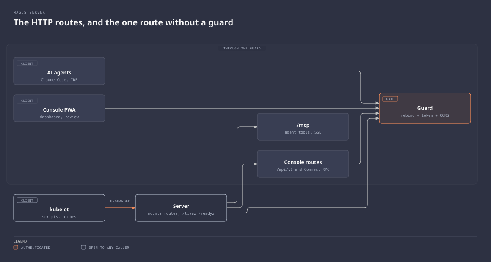
</picture>

<picture>
  <source media="(prefers-color-scheme: light)" srcset="docs/assets/gen/diagram-server-socket-light.svg">
  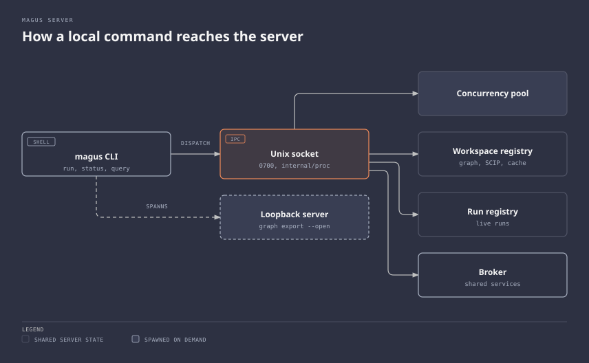
</picture>

<picture>
  <source media="(prefers-color-scheme: light)" srcset="docs/assets/gen/diagram-server-jobs-light.svg">
  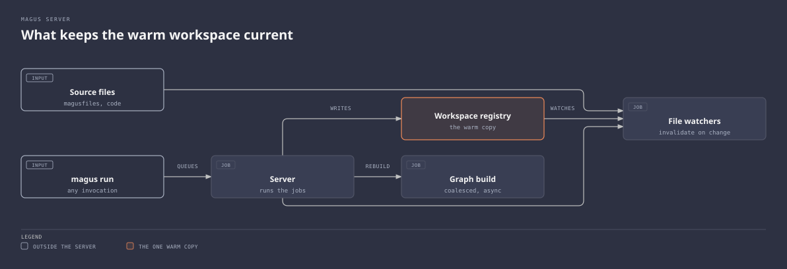
</picture>

<picture>
  <source media="(prefers-color-scheme: light)" srcset="docs/assets/gen/diagram-server-share-light.svg">
  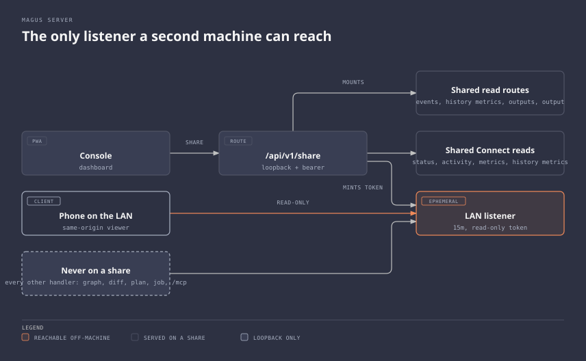
</picture>

## The browser console

Alongside the CLI, the daemon can drive a set of read-only browser apps. The [live demo](https://eli.gladman.cc/magus/console/) runs with no install and no daemon.

<!-- The architecture figures take their design system from the same project's diagram-design skill (MIT), which magus/figure renders. -->
<!-- Grid layout after cathrynlavery/diagram-design's README gallery. Screenshots are
     regenerated by ./hack/docs/screenshots.sh against each console app's #demo showcase. Two of them are
     MODES of the dashboard rather than apps of their own, which is why they carry the key that
     reaches them; Big Picture takes the full width because losing the chrome is the whole point
     of it. The last row is the same console on a phone (375x812, device emulation on): a
     different design rather than the same one squeezed, and with the larger touch targets that
     come with it. -->
<table>
  <tr>
    <td align="center" width="33%">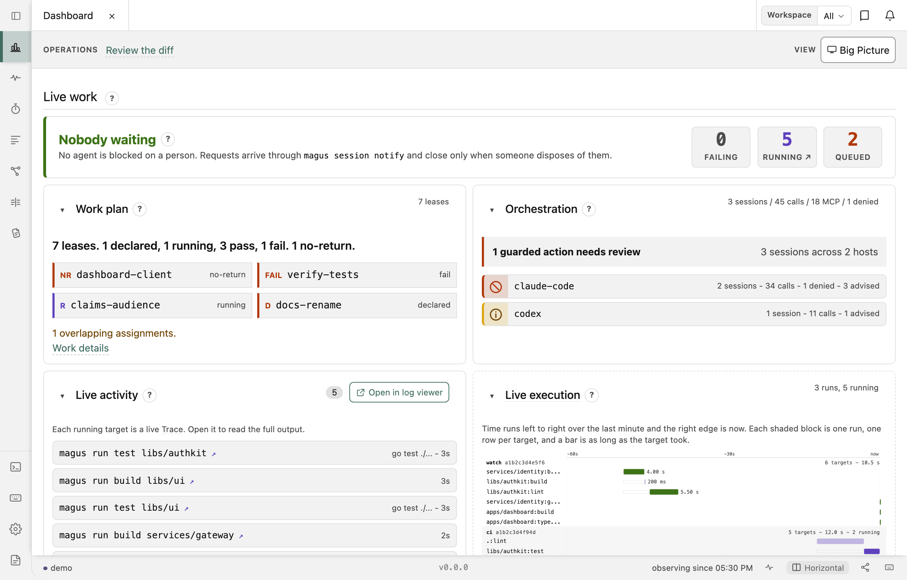<br><b>Dashboard</b><br><sub>Pool, cache and daemon health, live</sub></td>
    <td align="center" width="33%">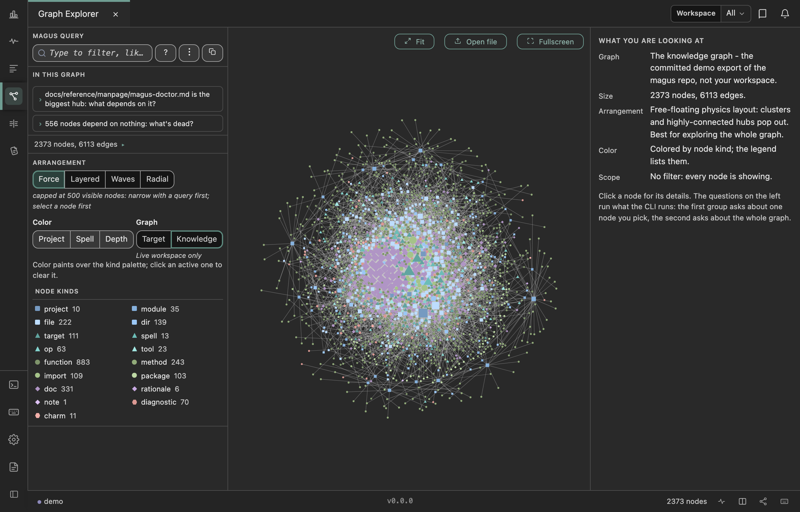<br><b>Graph Explorer</b><br><sub>Targets, spells and their dependencies</sub></td>
    <td align="center" width="33%">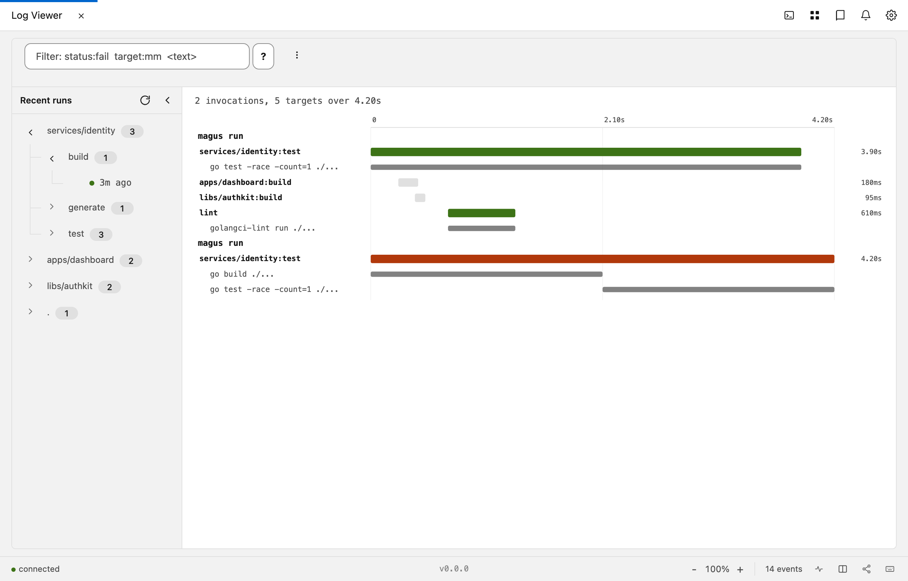<br><b>Log Viewer</b><br><sub>Any run's captured output, streamed or replayed</sub></td>
  </tr>
  <tr>
    <td align="center" width="33%">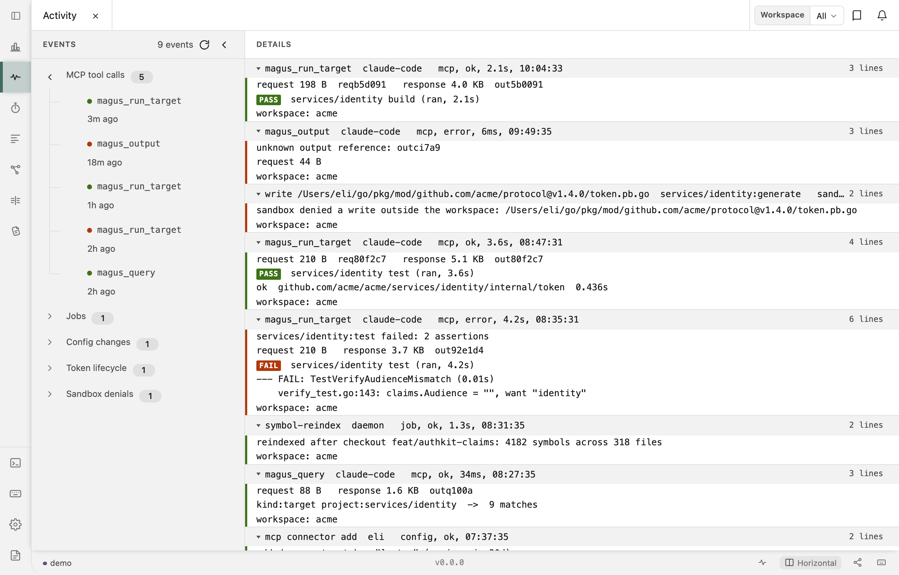<br><b>Activity Trail</b><br><sub>What agents did, and when</sub></td>
    <td align="center" width="33%">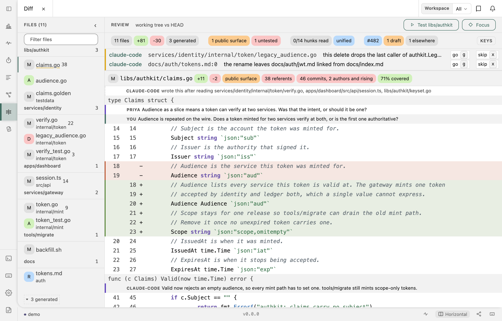<br><b>Diff</b><br><sub>Review the working tree, paired with an agent</sub></td>
    <td align="center" width="33%">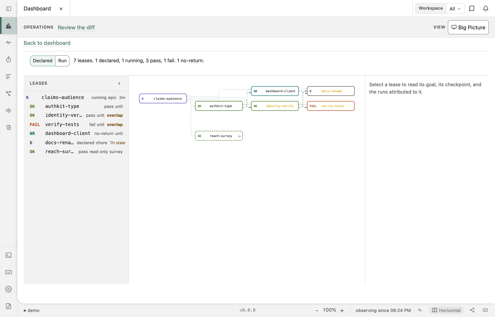<br><b>Work plan</b><br><sub>Who holds which lease, and where two of them overlap (press <code>p</code>)</sub></td>
  </tr>
  <tr>
    <td align="center" colspan="3">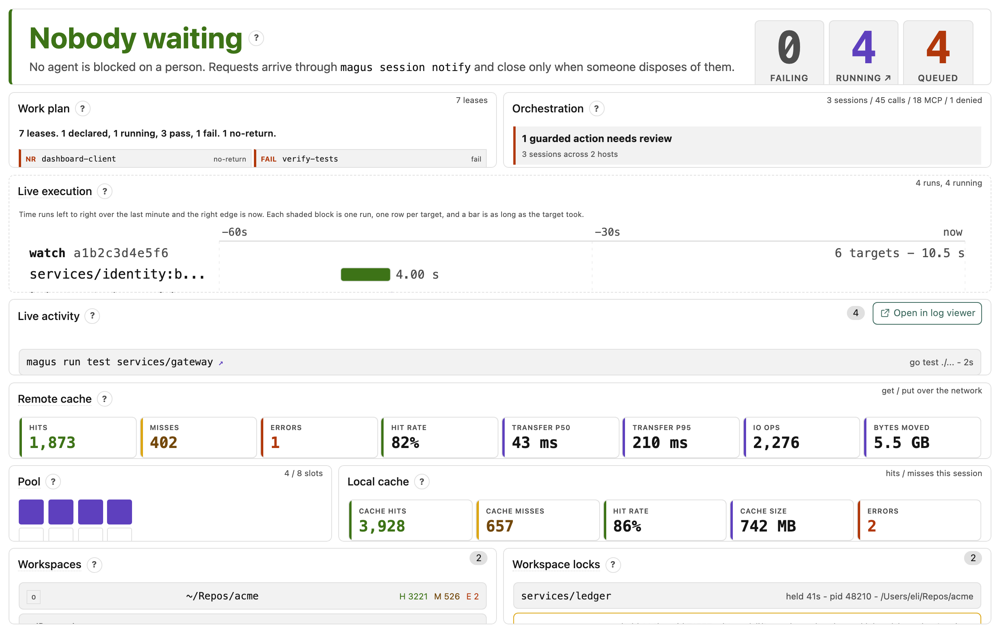<br><b>Big Picture</b><br><sub>The same dashboard with the console's own chrome gone, for a wall display (press <code>b</code>)</sub></td>
  </tr>
  <tr>
    <td align="center" width="33%">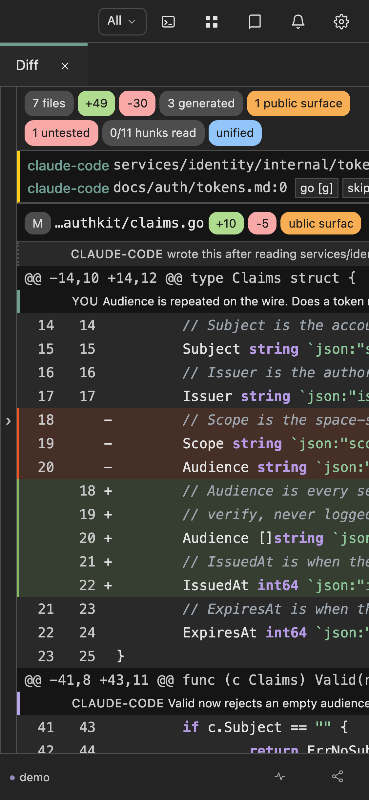<br><b>Diff, mobile</b><br><sub>The file index folds to a rail; split view falls back to unified</sub></td>
    <td align="center" width="33%">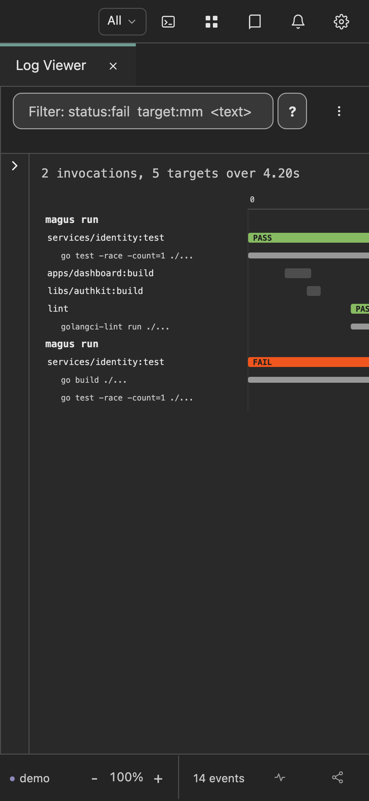<br><b>Log Viewer, mobile</b><br><sub>The waterfall keeps its drawn size and scrolls, rather than shrinking its labels away</sub></td>
    <td align="center" width="33%">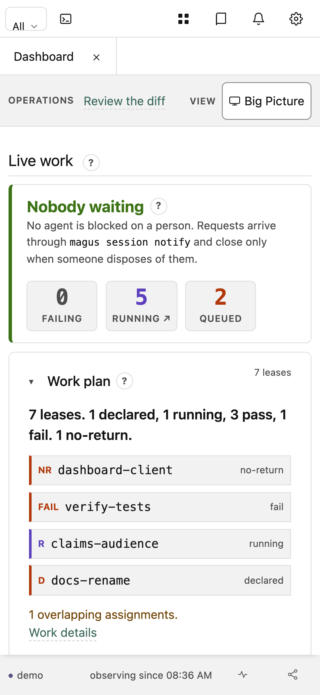<br><b>Dashboard, mobile</b><br><sub>Tiles stack, the rail gives way to the launcher grid, and controls take a 44pt touch target</sub></td>
  </tr>
</table>

- [Dashboard](https://eli.gladman.cc/magus/console/dashboard/) shows live daemon health, the concurrency pool, running targets, cache activity, and the live lease plan.[^app-dashboard]
- [Graph Explorer](https://eli.gladman.cc/magus/console/graph/) navigates targets, spells, and their dependency graph (`magus graph export --open`).[^app-graph]
- [Log Viewer](https://eli.gladman.cc/magus/console/logs/) reads or streams any past run's captured output (`magus query output <ref> --open`).[^app-logs]
- [Activity Trail](https://eli.gladman.cc/magus/console/activity/) shows recent MCP calls, agent-command observations, background jobs, and config changes.[^app-activity]
- [Diff](https://eli.gladman.cc/magus/console/diff/) annotates the working tree's uncommitted changes (generated vs source, blast radius, coverage) and hosts the human half of a paired review.

The hosted page talks only to the daemon on `127.0.0.1`/`[::1]`, or receives your graph inline through a URL fragment, and uploads nothing; the [Console reference](docs/reference/console.md#where-the-pages-come-from) covers where the pages come from and how to turn them off.

## Working with AI agents

magus ships skills, MCP tools and hints built on the knowledge graph, so an agent asks magus instead of grepping and guessing.

- Installable skills teach an agent to query the graph, run work through targets, and triage generated files. For Codex, run `magus agent install .agents/skills` and paste the always-on `AGENTS.md` block it prints. Claude Code uses `.claude/skills`; there is a setup page per host behind [Agents](docs/guides/integrations/agents.md).
- The committed `MAGUS.md` is a routing index, regenerated from the graph, that points an agent at the exact query for a given question.
- The MCP server the daemon exposes lets an agent call magus tools directly over the protocol rather than shelling out.[^mcp]
- The guard hook judges a command or a write before an agent runs it, from rules that live in the binary rather than in per-host integration code. The host-shaped wiring is a template you copy and own; [The host wiring is yours](docs/design/judgment/the-host-wiring-is-yours.md) records that design.

## Documentation

Full docs live at **[eli.gladman.cc/magus](https://eli.gladman.cc/magus/)**.[^docs-source] The major sections:

- Core concepts: [Targets](docs/concepts/targets.md), [Spells](docs/concepts/spells.md), [Charms](docs/concepts/charms.md), [Operations](docs/concepts/operations.md), [Services](docs/concepts/services.md)
- Running at scale: [CI](docs/concepts/targets/ci.md), [CI providers](docs/concepts/ci/providers.md), [Daemon](docs/guides/integrations/server.md), [Remote caching](docs/concepts/cache/remote.md), [MCP](docs/guides/integrations/mcp.md), [Telemetry](docs/concepts/telemetry.md)
- Reference: [Man pages](docs/reference/manpage/magus.md), [Standard library modules](docs/reference/buzz/index.md), [Testing](docs/guides/testing.md), [Debugging](docs/guides/debugging.md), [Output references](docs/concepts/cache/output-refs.md), [Tips and tricks](docs/guides/tips.md)
- Design: [Design principles](docs/design.md), [A measure is not the goal](docs/design/principles/a-measure-is-not-the-goal.md)

Inside a workspace, the entry point is the committed [`MAGUS.md`](https://github.com/egladman/magus/blob/main/MAGUS.md),
a routing index of the workspace's projects, targets and graph queries that
`magus describe graph -o markdown` generates through the `generate` target.

## Development

magus is built and tested by magus, so this repository is a magus workspace like any other. Parts of the contributor reference are generated from the workspace's own graph:

- The [project catalogs](https://eli.gladman.cc/magus/development/projects/) give one page per project: every runnable target, what it depends on, which toolchains it drives, and a run-order diagram built from the real `ctx.needs` edges.
- The [workspace dependencies](https://eli.gladman.cc/magus/development/projects/) page lists the projects in dependency order, with each one's blast radius: how many projects a change there can reach.
- The [contributing guide](https://eli.gladman.cc/magus/development/contributing/) covers the conventions worth knowing before opening a pull request, including the benchmark-evidence rule for performance changes.
- The [configuration reference](https://eli.gladman.cc/magus/reference/config/) lists the `magus.yaml` keys and the `MAGUS_*` environment inventory.

### Building from source

```sh
mise install              # the pinned Go, Node, and esbuild
magus run go-build .      # writes ./magus
```

`go-build` regenerates the compiled built-in spells before it links, so the binary never embeds stale bytecode. It is the target to use over `build`, which also runs the format and image stages.

Without a magus, [install a release](https://eli.gladman.cc/magus/guides/setup/) and point it at your checkout.
Failing that, a clone with no magus and no release bootstraps one with Go directly, the one place a raw `go build` (or `go run`) belongs:

```sh
GOEXPERIMENT=jsonv2 go run -trimpath ./cmd/magus run go-build --no-cache .   # bootstrap only
```

`GOEXPERIMENT=jsonv2` is not optional: magus refuses to compile without it. [`mise.toml`](https://github.com/egladman/magus/blob/main/mise.toml) sets it for this repository, and the bootstrap carries it so the line works where mise does not.

Under an agent hook the guard holds that order: it lets that exact line through, alone on its line, in a checkout with no `./magus`, refuses every other raw go command there (a bare `go build -o magus ./cmd/magus` included) and serves the bootstrap, and denies every raw build after that in favor of `./magus run go-build .`.

<picture>
  <source media="(prefers-color-scheme: light)" srcset="docs/assets/gen/diagram-bootstrap-light.svg">
  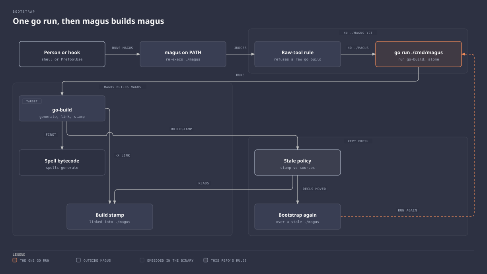
</picture>

### Running the tests

Run the tests through magus:

```sh
magus run ci
```

[^docs-source]: Source: [docs/](https://github.com/egladman/magus/tree/main/docs).

[^playground]: You can run Buzz in your browser, no install, at the [Playground](https://eli.gladman.cc/magus/playground/); the [standard library modules](docs/reference/buzz/index.md) are the API reference.

[^scip]: [SCIP](https://sourcegraph.com/docs/code-search/code-navigation/writing_an_indexer) is Sourcegraph's code-index format. magus indexes on its own once a project uses the `scip` op, stores the index in the cache, and refreshes it in the background; the [knowledge graph](docs/concepts/knowledge.md) page covers the symbol layer and the `@symbols` shard.

[^app-dashboard]: What the tiles mean, and the metrics behind them: [Telemetry](docs/concepts/telemetry.md) and the [daemon](docs/guides/integrations/server.md) page.

[^app-graph]: The same graph the CLI queries, drawn. See [`magus graph`](docs/reference/manpage/magus-graph.md) for the verbs and [knowledge graph](docs/concepts/knowledge.md) for the schema.

[^app-logs]: A run's output is addressed by a short reference ID, which is what `<ref>` is above. See [output references](docs/concepts/cache/output-refs.md).

[^mcp]: Tool list, transport, and how to connect an agent: [MCP](docs/guides/integrations/mcp.md).

[^app-activity]: The trail is the daemon's own record, kept in memory per workspace. See the [daemon](docs/guides/integrations/server.md) page.
