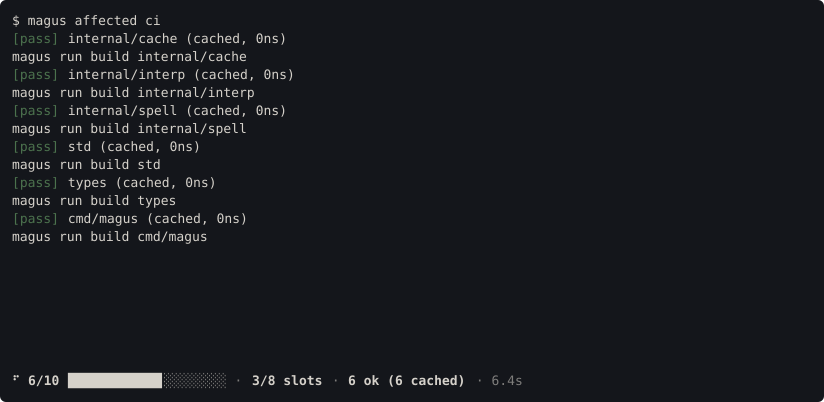
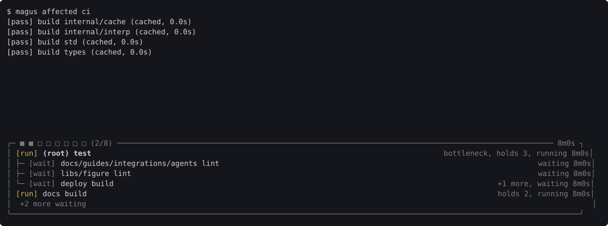
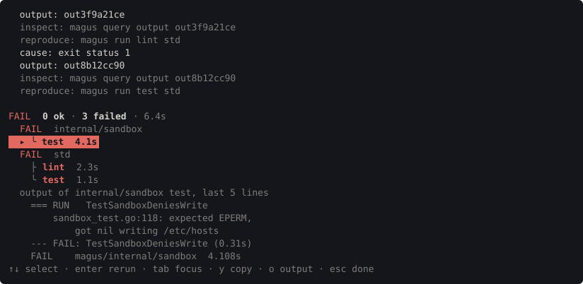
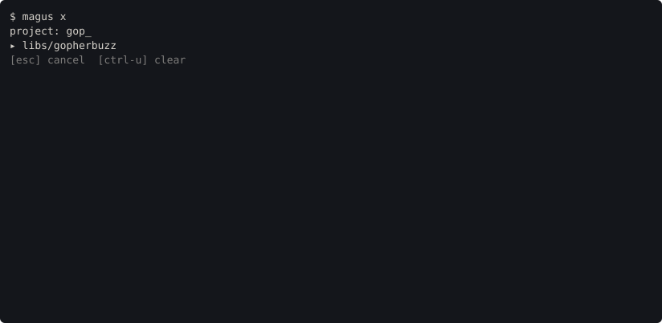

# Terminal

magus draws in your terminal without taking it over. There is no alternate
screen, and your scrollback survives: ordinary output keeps scrolling exactly
as it would, while a few rows at the bottom hold still and show what is
happening right now.

The one exception is `magus server status --watch`: each frame normally redraws in
place, but a frame taller than your terminal has nowhere to redraw to, so that
one case clears the visible screen and reprints. Scrollback still survives:
clearing is not the alternate screen buffer, so what scrolled past before is
still there when you scroll up.

Everything on this page degrades to plain output when there is no terminal to
draw on: a pipe, a CI log, a `magus` inside another tool, or a real terminal
whose `TERM` declares it understands no escape sequence (`TERM=dumb`, which
Emacs shell-mode sets), so all of those behave the way they always did.
`magus doctor` reports which way your terminal degraded, if it does.

## The pinned band

The bottom rows of the terminal are reserved. Output above them scrolls
normally (selectable, copyable, in real scrollback), and the reserved rows do
not move with it.



The band is plain rows of text. There is no frame, no rule above it, and no
padding to the edge of the terminal, so each row ends where its words end. The
band and the failure list both read this way, and so does the `magus x` picker.
[Terminal output stays copyable](../design/principles/terminal-output-stays-copyable.md)
says why.

The first row is a live status line: a spinner, how many planned targets have
finished with a bar to show it, how many pool slots are working, how many
targets are queued, how many passed and failed, and how long the run has been
going. A clause with nothing to say is left out. The spinner turns while
anything is in flight, and gives way to the word `ok` or `FAIL` when nothing
is. A failing project's row starts with `FAIL` too, so the status reads without
color and copies as a word. The row repaints in place rather than printing
again, so it costs nothing to watch and never fills the transcript.

The spinner is the `log.loader` config key: any glyph, rotation or strip loader
from [termkit](../reference/termkit.md), `glyph/dots` by default. A terminal
whose locale is not UTF-8 gets `glyph/line`, which is ASCII, and `magus doctor`
says so. The tree branches and the bar stay multi-byte, which is a deliberate
trade: the environments that still run non-UTF-8 locales (CI, cron, minimal
containers, `LANG=C` scripts) are the ones where output is piped and no band is
drawn at all. A committed screenshot draws Unicode whatever shell recorded it.

### What a target is waiting on

When targets wait on other targets, the band draws the wait as a tree under the
status row. Each root is a target that is running, or queued for a seat, with
the spinner in front of it and the targets waiting on it beneath it, and theirs
beneath those. Roots are sorted by how many targets they hold, and the first is
marked `bottleneck`. Each row says how long the target has run or waited, and
`+N more` on a waiting row counts the other unfinished targets it also waits on.
That metadata starts in one column, after the longest label.



A wait shows once it passes three seconds, so a cached run does not flicker.
The band repaints every 80 milliseconds while targets are in flight, which turns
the spinner, and stops repainting when nothing is. Past six rows its last row
counts the waiting targets left out.

While the tree shows a wait, the `is waiting for ... to finish` line for it is
not printed. Without a band (a pipe, a CI log, `-o json`), that line prints as
before.

The band claims rows only when there is something to put in them, gives them
back when the run ends, and stands down entirely on a terminal too short to
leave a useful scrolling area above it.

## Notifications

A notification is for something you have to ACT on. That rule is strict, and it
leaves magus itself raising none during a run: a cache hit is passive, a summary
is already on screen, and a failure is already pinned where it cannot scroll away.
A run that finds a project lock or the machine budget held by another magus
invocation does not wait behind it, so there is no stalled run to announce; it
exits 75 naming the holder.

A magusfile can raise its own with
[`term\notify`](../reference/buzz/term.md). Those expire on their own clock, and
are dropped rather than replayed when there is no terminal, so log anything
that also has to survive the run.

## Failures you can act on

When a run ends with failures, they stay on screen instead of being cleared,
because that is the moment they become actionable:



Click a failure, or select it with the arrow keys, and:

- **enter** reruns just that target with `--step`, pausing before each command
  so you can look at what is about to happen
- **tab** moves rows between the failure list and its output
- **y** copies the output to your clipboard
- **o** prints its captured output into the scrolling transcript
- **esc**, **q** or **ctrl-c** leaves

The selected failure's output appears under the list, headed with the target it
belongs to. With the list in focus the whole list shows and the output takes the
rows left, newest lines last. Press tab and the list collapses to the selected
failure, marked `(1 of 3)`, and the output takes the rest.

The way out is always on screen. When the terminal is too narrow for every
hint, whole hints drop from the right and the way out stays, so no hint is cut
in the middle of a word.

## Clicking

The picker behind `magus x`, and the failure list above, both take a mouse.
Hovering moves the highlight, so what a click would take is never a guess:



Keys still do everything the mouse does. The mouse is captured only while magus
is genuinely waiting on you (never during a run), so drag-to-select and your
scroll wheel keep working the rest of the time.

Clicking needs your terminal to answer a cursor-position query. Most do; one
that does not leaves the picker keyboard-only, and `magus doctor` says so rather
than leaving you to wonder.

## Copying

Your transcript is ordinary scrollback and always was: no frame, no padding, no
box characters. Selection, copy and paste work there exactly as they do for any
other command, and that is where magus prints the things worth taking: a
failure's cause, its output reference, and the `magus run <target> <project>`
that reproduces it.

The pinned band is real text too. It has one column, no frame and no trailing
spaces, so a drag over it copies the words you see and nothing else. The failure
output sits under the tree rather than beside it for the same reason: a drag
down one column would otherwise take the other.

Two keys skip the selecting. Press **y** and the selected failure's captured
output goes straight to your system clipboard (the bytes the tool emitted, with
no padding and no escape sequences) through a sequence that survives ssh and
tmux. Press **o** and the same output is printed into the transcript, where it
copies like anything else.

A terminal that refuses clipboard writes (some disable them) says so in a
notification rather than failing the run, and **o** still works.

## When there is no terminal

Nothing above happens on a pipe, in CI, or under a tool that captures output.
The band is never reserved, notifications are dropped, color and hyperlinks are
omitted, and every message that matters is printed as an ordinary line. The
distinction magus keeps is between a RECORD and a VIEW: a failure is a record
and is always printed somehow, while a repainted status line is a view and is
not shown when there is nowhere to repaint it.

`magus doctor` reports what it found:

```text
[pass] terminal capabilities: interactive terminal, fully capable
    TERM="xterm-256color"
    display is a terminal: yes
    input is a terminal: yes
    mouse: yes
    log format: "pretty" (from config)
    size: 120x40
    color: yes
    hyperlinks: yes
```

The log format is reported first because it decides the question before your
terminal gets a say: `text` and `json` emit structured records and draw no
interactive view at all, however capable the terminal is.
