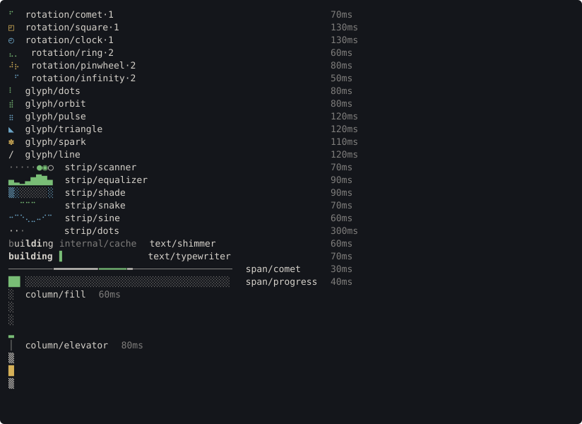

# termkit

termkit is the terminal UI library magus draws its own output with. It lives in
`libs/termkit` as its own Go module, depends on `golang.org/x/term` alone, and
every exported function and type is also a Buzz module. magus's run band is one
consumer of it; a magusfile or a Go program can be another.

It follows [Terminal output stays copyable](../design/principles/terminal-output-stays-copyable.md):
rows end at their last word, nothing is framed or padded to the edge, and a
pinned zone is erased when it is released.

## Packages

Each Go package is one Buzz module, imported by the same path under `termkit`.

| Go import                                         | Buzz import                 | What it holds                                                    |
| ------------------------------------------------- | --------------------------- | ---------------------------------------------------------------- |
| `github.com/egladman/magus/libs/termkit`          | `import "termkit"`          | `Zone`, `Lease`, `Line`, `Span`, `SGR`, `Probe`, `Colorize`      |
| `github.com/egladman/magus/libs/termkit/layout`   | `import "termkit/layout"`   | `Cols`, `Fit`, `Columns`, `Tree`, `Hints`                        |
| `github.com/egladman/magus/libs/termkit/progress` | `import "termkit/progress"` | the loaders and `Bar`                                            |
| `github.com/egladman/magus/libs/termkit/pick`     | `import "termkit/pick"`     | `One`, the interactive picker                                    |
| `github.com/egladman/magus/libs/termkit/notify`   | `import "termkit/notify"`   | `New`, a stack of expiring notifications                         |
| `github.com/egladman/magus/libs/termkit/screen`   | `import "termkit/screen"`   | `New`, a fake terminal with `Rows` and `TrailingSpaceRows`       |

Imports point toward the root: every package may import `termkit`, none
imports a sibling.

## Go

```go
z := termkit.NewZone(os.Stderr, termkit.SystemProbe)
defer z.Close()
band := z.Acquire(2)

dots, err := progress.Lookup("glyph/dots")
if err != nil {
	return err
}
start := time.Now()
for range time.Tick(dots.Interval) {
	spin := dots.Frame(time.Since(start))[0].Spans
	row := append(spin, termkit.Span{Text: " building internal/cache"})
	if _, err := band.Set([]termkit.Line{{Spans: row}, progress.Bar(3, 8, 20, termkit.SGRDim)}); err != nil {
		return err
	}
}
```

A frame is a pure function of elapsed time, so the same instant always draws
the same frame. Test against `screen.New(80, 24)` instead of a real terminal and
assert `TrailingSpaceRows()` is empty.

## Buzz

A Go value with state crosses into Buzz as an int handle, and a record as a map.
Writers are standard error and readers standard input. A probe is a handle,
and `termkit\systemProbe()` is the one that asks the operating system. Go
constants and variables are functions of no arguments: `termkit\sgrDim()`.

```buzz
import "std";
import "termkit";
import "termkit/progress";

fun main(args: [str]) > void !> any {
    final zone = termkit\newZone(termkit\systemProbe());
    final band = termkit\zoneAcquire(zone, rows: 1);
    final dots = progress\lookup("glyph/dots");
    final frame = progress\loaderFrame(dots, elapsed: 160);
    _ = termkit\leaseSet(band, rows: frame);
    termkit\zoneClose(zone);
    std\print("{progress\loaderName(dots)} draws every {progress\loaderInterval(dots)} ms");
}
```

A Go method is a Buzz function named for its type and method: `Zone.Acquire`
is `zoneAcquire`, taking the handle first. The bindings and declarations are
generated from the Go source at build time by `magus-utils libmodules`, and a
test fails when an exported function or type has no binding.

## Loaders

Every loader has a name, an interval and a fixed footprint. Look one up by name;
an unknown name is an error that lists them all.

| Kind       | Footprint             | Loaders                                                                            |
| ---------- | --------------------- | ---------------------------------------------------------------------------------- |
| `rotation` | 1, 2 or 3 columns     | `comet·1`, `square·1`, `clock·1`, `ring·2`, `pinwheel·2`, `infinity·2`             |
| `glyph`    | 1 column              | `dots`, `orbit`, `pulse`, `triangle`, `spark`, `line`                              |
| `strip`    | 8 columns             | `scanner`, `equalizer`, `shade`, `snake`, `sine`, `dots`                           |
| `text`     | the label's width     | `shimmer`, `typewriter`                                                            |
| `span`     | the width you give    | `comet`, `progress`                                                                |
| `column`   | the height you give   | `fill`, `elevator`                                                                 |

`glyph/line` is ASCII and is what to draw where the locale is not UTF-8. The run
band's loader is the `log.loader` config key; it takes any glyph, rotation or
strip loader and defaults to `glyph/dots`.


