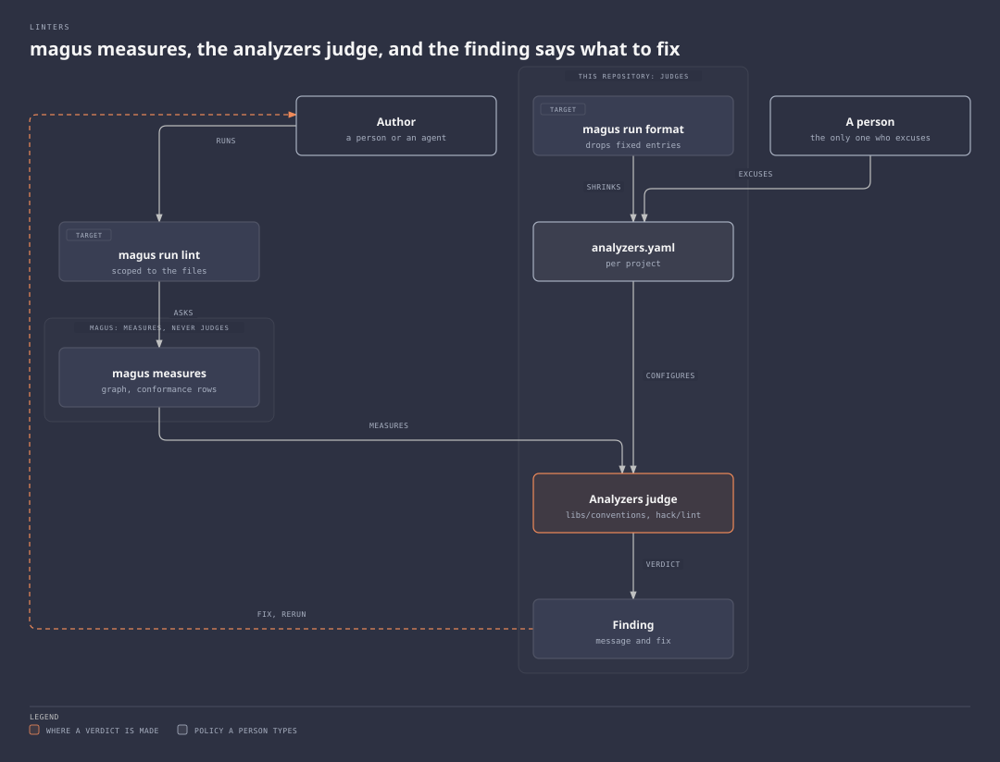

# conventions

Go analyzers for this repository's own rules over Go source. Each one was a test
in the root `conventions_test.go` that walked the tree as text; as an analyzer it
runs in `magus run lint` beside the stock linters, reports at the offending line,
and takes a `//nolint:<name> // <reason>` where an exception is deliberate.

| Linter          | Reports                                                                                                                                                                                     |
| --------------- | ------------------------------------------------------------------------------------------------------------------------------------------------------------------------------------------- |
| `hostagnostic`  | a line of non-test source naming an agent host outside a filesystem path                                                                                                                    |
| `hostvocab`     | a host's tool name (`"Read"`, `"Bash"`) as a string literal in guard code                                                                                                                   |
| `ruletext`      | guard rule text (`"magus workspace:"`) in the guard's CLI half                                                                                                                              |
| `accessorclone` | an exported accessor returning its own slice or map instead of `slices.Clone`, `maps.Clone` or an iterator; today's cases sit in the module's `analyzers.yaml` baseline, which only shrinks |
| `clikitmain`    | a main package that parses its command line by hand: a `flag` definition or parse, or a read of `os.Args`; today's cases sit in `analyzers.yaml`, which only shrinks                        |
| `asciistrings`  | a typographic glyph in a string literal of a listed user-facing file                                                                                                                        |
| `benchbeside`   | an `// optimization:` comment or a `Cache`/`Memo` type in a package whose tests hold no benchmark                                                                                           |
| `closedswitch`  | a switch over a named type with declared constants that misses a member or keeps a default arm                                                                                              |
| `stutter`       | an exported package-level name opening with its package's name                                                                                                                              |
| `filenames`     | a Go file name segment that splits into two segments the tree uses as file names                                                                                                            |
| `nameoutput`    | a `case outputName:` arm that does not render through an emitter                                                                                                                            |
| `namewords`     | a function or method name, exported or not, ending in a listed word (`Of`, `For`, `From`, `To`) or using a listed short form (`Src`, `Ctx`)                                                 |
| `testisolation` | a test binary linking the runtime-directory package with no isolating `TestMain`                                                                                                            |
| `globalrestore` | a test assigning a configured package-level variable with no `t.Cleanup` or `defer` restoring it                                                                                            |
| `fieldwise`     | a test asserting every field of a struct one at a time instead of comparing the whole value once                                                                                            |
| `providerio`    | Go source outside an allowlist reaching toward a CI/VCS provider (an HTTP client, or a provider SDK import)                                                                                 |
| `diagmsg`       | a diagnostic that runs long, stacks reasons, names two commands or opens with a one- to three-word tag                                                                                      |
| `errmsg`        | an error joining clauses, misplacing `%w` or naming the wrong origin, or an error's text in a log record                                                                                    |
| `stderrprint`   | a write to `os.Stderr` outside a usage function and the display, which the verbosity flags never see                                                                                        |
| `inlineliteral` | a private function a change touches that returns one literal value (a builder, a literal, a getter) and has few use sites                                                                   |
| `passthrough`   | a private function a change touches whose body is one call and that has few use sites                                                                                                       |

`closedswitch` is declared by a person, not mined: the tree sits under the 0.8 adoption floor. The
`exhaustive-switch` key of the `analyzers.yaml` at the root of the module that holds the file
holds its `baseline`, one count of violating switches per function, which may only shrink, and its
`exits`, the switches a person accepted, each with a reason. A module with no such key allows none. A `//nolint:closedswitch` is no exit; `hack/lint/closed-switches-name-every-member.buzz`
refuses it and judges the TypeScript and Buzz halves of the same rule against the `analyzers.yaml` of their own project.

Every path, word list, host name, ceiling and exemption lives in the root
`.golangci.yml`, so the analyzers carry the mechanism and the config carries the
policy. No diagnostic names this repository's identifiers or paths on its own: an
analyzer whose remedy is repository-specific takes a `hint` setting, appended to
each of its diagnostics. An analyzer with a baseline or exits a person types
(`accessorclone`, `closedswitch`) reads them, with its `hint`, from its own key of the
`analyzers.yaml` at the root of the module it lints (`closedswitch`: the nearest module above each file). A module with no such file
has no baseline and gets the strict default.

`diagmsg` holds a `log/slog` message to the tag rule alone, and never lets an
allowlist exempt one: a record names what logged it with `attr.Component`, not a
tag in its text. `errmsg` judges a `log/slog` call too. `error-log` reports an
error built into a message, and `error-attr` an error's text passed as an `error`
or `err` attribute; both belong in `attr.Error`, so the display names the error's
origin once.

## How it fits

magus measures, these analyzers judge, and each project's `analyzers.yaml`
configures them. [How the linters work](../../docs/concepts/linters.md) explains
the order a finding is decided in.

<picture>
  <source media="(prefers-color-scheme: light)" srcset="../../docs/assets/gen/diagram-linters-loop-light.svg">
  
</picture>

## Scope

golangci-lint stops at a `go.mod`, so the root `lint` target runs it once more in
each module under `libs/`, on the same config, with only `filenames`,
`hostagnostic`, `namewords`, `stutter`, `testifylint`, `testpairing`,
`testpair` and `clikitmain` enabled, plus `errmsg` outside gopherbuzz: the rules that hold in
every module. The rest name root-module paths.

`filenames` reads beyond its package on purpose: its vocabulary is every Go file
name the go tool would read under the root of `module`, nested modules included,
walked once when the plugin loads. Like the go tool, the walk never enters a dot
or underscore directory or `testdata`. Rules over source text also read the files
a package's build constraints exclude on this platform, so a darwin run still
checks the `_linux.go` files the walks did.

A setting that names a path (`files`, `package`, `dirs`, `skip-dirs`) is checked
against the tree when the plugin loads, from the directory whose `go.mod`
declares `module`. A pattern matching no file, a package or directory with no Go
files, or a skip entry naming no directory that holds Go files, is a load error
naming the setting: a scope that matches nothing would otherwise report nothing,
and a skip entry that matches nothing is a setting the tree moved out from under.

`stutter` reads the package name from the package clause, which is what a call
site spells, and skips `package main`, which has none. Its zero settings check
every package name of three bytes or more.

`testisolation` carries reach as a package fact along imports, which needs type
information; the rest load types only because golangci-lint leaves the package
unset without them.

`globalrestore` reads test files only. It reports the first assignment in a test
function, a subtest closure or a helper taking a `*testing.T` to a configured
variable, or to a field or element of one, unless that function (or an enclosing
test) hands `t.Cleanup` or `defer` a closure assigning the variable or a package
function that does, such as `t.Cleanup(snapshotGlobals())`. A configured `vars`
name its package does not declare is a load error.

`fieldwise` reads test files only. Its zero settings report a value whose
assertions name every field its struct declares, which one comparison of the
whole value replaces exactly. `report-partial` adds a value asserted on two or
more of its fields: that fix compares fields the test never looked at, so it may
need volatile fields normalized first. This tree turns it on: once a struct grows
a field, a test that named every field asserts only some, and only
`report-partial` still reports it.

`errmsg` judges a plain Go error, which its callers extend with ": " as it
wraps: `error-join` reports `"; "`, `" - "` or an em dash, `error-newline` a newline,
`error-sentences` a period followed by more text outside quotes and
abbreviations, and `error-wrap` a `%w` anywhere but an opening `"%w: "` or a closing `": %w"`. A
`fmt.Errorf` built only to wrap inside a coded diagnostic is still judged; the
diagnostic's own constructor is `diagmsg`'s. Capitalization and trailing
punctuation are staticcheck's ST1005.

The error that originates a failure names its origin once, and a wrap adds what
its own call was doing. `error-origin` reports a leading `"name: "` naming another
package of the module, read from every package clause under `module`;
`operations` lists the names that are also commands (`run`). `error-stutter`
reports a wrap opening with its own package's `"name: "` around a variable last
assigned from a call into that package, which already named it.
`error-notice` reports an error built into the message of a log record that
carries one of `notice-attrs`: the record names who is speaking, the error rides
as an attribute, and the display names a shared origin once.

`namewords` judges only declared functions and methods, exported or not, split
into words at underscores, camel-case boundaries and digit runs. It skips a test,
benchmark, fuzz or example entry point, a generated file, and a method that
satisfies an interface of a standard library package its package reaches, such as
`io.WriterTo`'s `WriteTo` and `io.ReaderFrom`'s `ReadFrom`. A one-word name is never
judged against `suffixes`, so `readlog.From` stays. A value read off a context is
named `XFromContext`, not `XFrom`. A short form is a clipped word (`Ctx` for context).
An initialism Go spells in caps, and a word the standard library spells the same
way, is not one.

`banned` keeps a word out of every declared name in some packages, so a word
reserved for one layer cannot leak into the types above it. Each entry lists
`packages` (an import path, or one ending in `/...` for the packages below it
too), `words` matched like the other lists, and `why`, printed with each report
to say what to name the thing instead. It judges each top-level name, struct
field and interface method, exported or not, and no parameter or local. The root
config bans `Row` and `Rows` in the root package and under `types/`: row names
the persistence layer only (ADR 0030).

## Thin helpers

`inlineliteral` and `passthrough` judge a private package-level function whose
body is one statement, with at most `max-sites` references in its package, tests
included. A private name is visible only there, so the count is exact. A
reference passing the function as a value counts as a site.

- `inlineliteral` reads a body returning one composite literal or its address,
  a basic literal or constant, or a name or field read. `v := E; return v` reads
  as `return E`, and a nil check returning nil before a returned literal is
  allowed, though the site must keep the check. A value use becomes a function
  literal at the site.
- `passthrough` reads a body that is one call, returned or made as a statement.
  A function passed as a value is not reported, since a table or a callback needs
  the name.

A function with two sites or more whose body holds more than `max-repeated-text`
runes of string literal is not judged either: inlining it writes the message at
each site, and two copies of one message drift apart.

Neither judges a method, an exported or generic function, `init` or `main`, a
function with a `//go:` directive, one whose body holds a function literal, or one
with a same-named declaration in a file the build excludes. Neither judges a body
of two statements that do work, so an extraction holding a branch or a loop always
passes.

Each site carries a fix that inlines it when the edit keeps the program's
meaning: every argument is a name, a literal or a field read, or one argument
with effects is read once by a body that makes no other call. A parameter whose
argument has another type, or a result the body computes at another type, is
converted, so a site's `x := f()` keeps its type. golangci-lint applies a fix
only within the file of its diagnostic, so a function is deleted by the next
`--fix` run, once nothing references it.

The tree still holds thin helpers, so both rules are scoped to a change like
`blankerror`: a function is reported only when a changed line since the merge
base with `base` meets its declaration. Pointing `base` at the root commit
reports the whole tree, which is how a sweep finds the rest.

Their only exits sit under the rule's key in the `analyzers.yaml` at the root of
the module holding the file:

```yaml
inlineliteral:
  exits: # a person keeps one; the reason is required
    - {path: internal/x/z.go, symbol: defaults, reason: "..."}
```

`path` is the declaring file inside the module and `symbol` the function's name.
An unknown field, an exit with no reason, or an exit naming a file that does not
exist is a load error. An exit whose function no longer departs is a finding at
its file's package clause, so a fixed helper takes its exit with it.

## Not here

Rules whose subject is not one package's Go source stayed tests: a vocabulary or
symbol index built from the whole tree (comments naming symbols that exist), and
rules that also read Buzz, shell or markdown
(environment sniffing, registered env vars, diagnostic raise sites, rescanning
string loops).

## proofread

`diagmsg` takes its message rules from proofread, the writing judge, which lives in
its own module: see [`libs/proofread/README.md`](../proofread/README.md).
