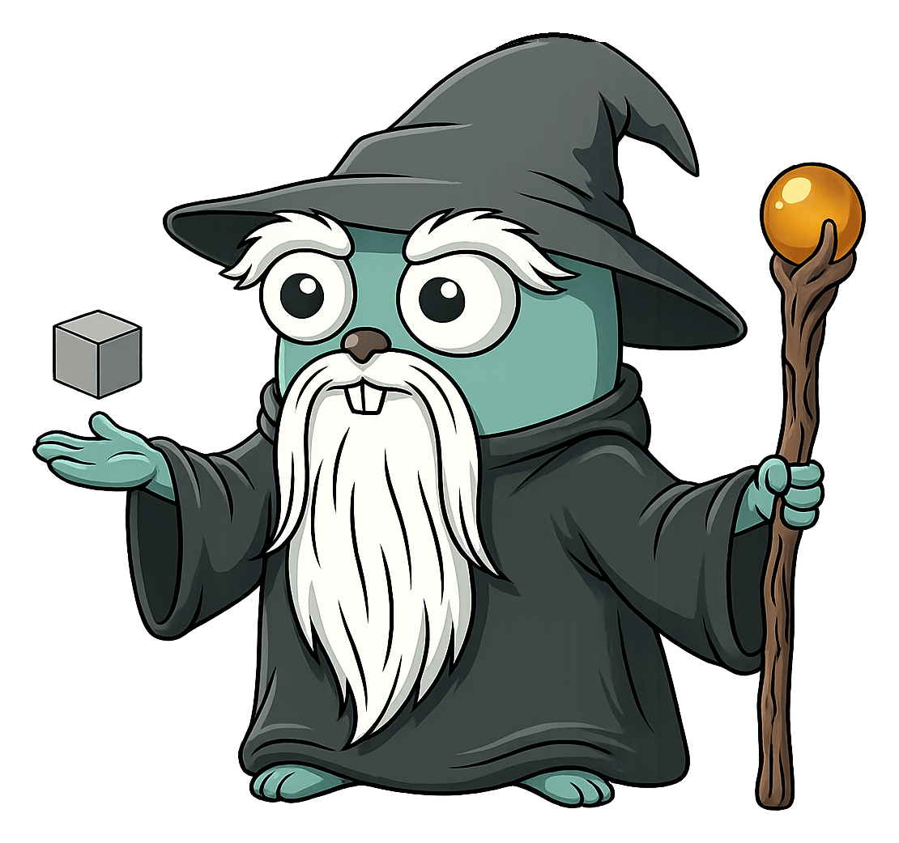
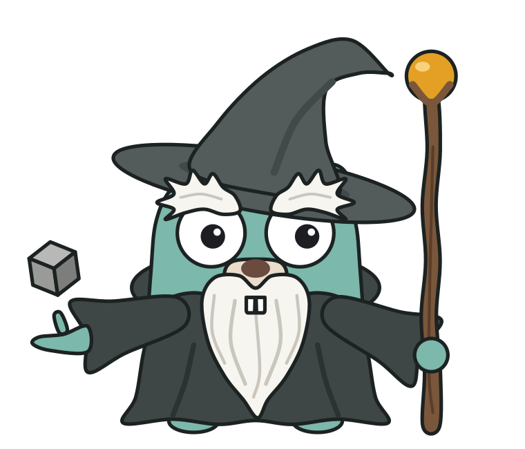
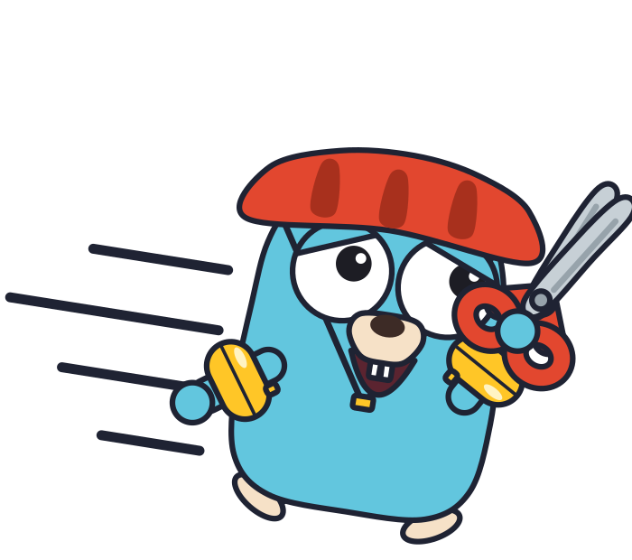
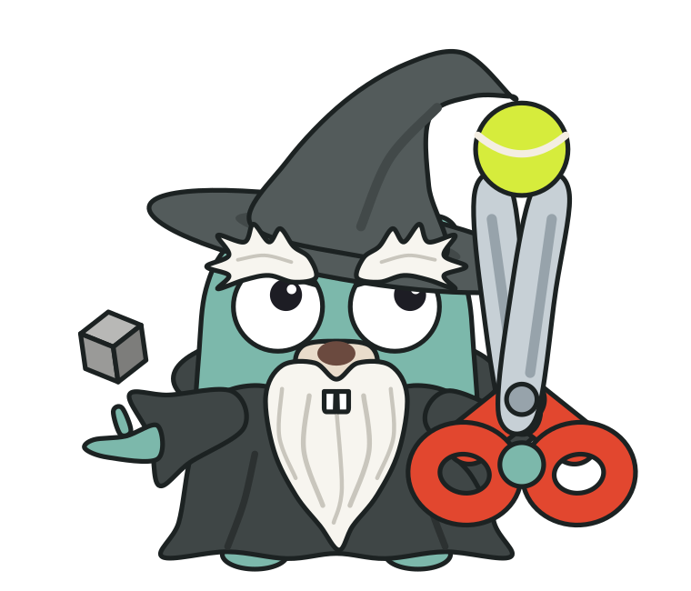
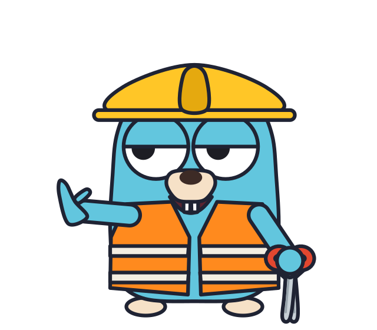

# libs/gopherart

Go gophers drawn from numbers in pure Buzz. A `Gopher` is the build: proportions,
palette, what it wears and holds. A `Pose` is where its joints sit at one moment.
`draw` takes a list of poses: one pose draws a still, and several draw one SVG whose
joints ease between them with SMIL and loop. Every joint is a nested group turned
about a pivot, so a prop in a hand follows the arm and the renderer does the curve
math.

```sh
magus run generate libs/gopherart    # every mark into gen/
```

## The marks

The magus wizard, current art on the left, the generated one on the right
([animated](gen/wizard-animated.svg)):

<p>
  
  
</p>

Three offers for the `libs/safetyscissors` mark. Each is a free figure on
transparency:

### Runner

Running with scissors, in every piece of gear there is
([animated](gen/safetyscissors-runner-animated.svg)).



### Sorcerer

The wizard traded his staff in. The tips were already round; the ball is for good
measure.



### Monitor

Carries them the way the poster says, and stops anyone who doesn't.



## Drawing one

```buzz
import "gopher";
import "safety";

fun main(args: [str]) > void !> any {
    final g = gopher\Gopher{ pal = safety\BRIGHT, mouth = gopher\Mouth.grin,
        rightHand = safety\scissors(safety\RED, size: 1.0, ball: false, angle: 0.0) };
    final wave = [
        gopher\Pose{ rightArm = 150.0 },
        gopher\Pose{ rightArm = 120.0, open = 1.0 },
        gopher\Pose{ rightArm = 150.0 },
    ];
    final drawn = gopher\draw(g, poses: wave, seconds: 1.2, id: "wave");
    if (drawn.error -> e) {
        throw e.message;
    }
    _ = gopher\save("wave.svg", svg: gopher\document(500.0, height: 450.0,
        body: gopher\place(drawn.value!, x: 250.0, y: 430.0, scale: 1.2)));
}
```

| file            | holds                                                                      |
| --------------- | -------------------------------------------------------------------------- |
| `gopher.buzz`   | the body, face, limbs, poses, joints and SMIL, and the SVG helpers         |
| `wardrobe.buzz` | the wizard's hat, robe, hood, beard and brows, a staff and a floating cube |
| `wizard.buzz`   | the magus wizard and its idle loop                                         |
| `safety.buzz`   | safety scissors, helmet, hard hat, vest, water wings, the three offers     |
| `marks.buzz`    | the list of marks `generate` writes                                        |

An `Accessory` draws on a `Layer` (behind, over the body, over the face, on the head,
in front); a `Prop` draws in a hand's frame and can stay upright whatever the arm
does. Both read the `Rig`, so one hat fits any build.

buzzed draws its icon with a sketch library of its own (`tools/sketch` in that
repository). This library takes nothing from it: a gopher needs smooth closed outlines
and pivots, which SVG's Béziers and transforms already give, so the only curve code
here is a Catmull-Rom spline.

## Credit

The Go gopher was designed by [Renee French](https://reneefrench.blogspot.com/) and is
licensed under [CC BY 3.0](https://creativecommons.org/licenses/by/3.0/). Every
drawing here is derived from her design.
