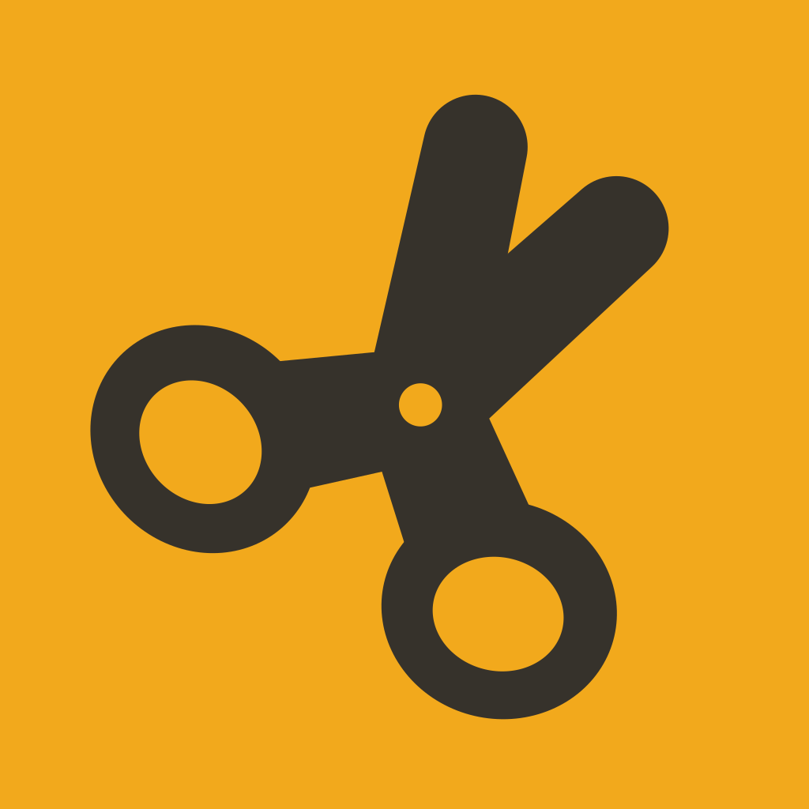

# libs/safetyscissors

The Go harness SDK for coding agents described in
[ADR 0050](../../docs/decisions/0050-the-harness-is-a-module-named-safetyscissors.md).
No footguns: it works fully and you can't hurt yourself.

## Mark

`assets/mark.buzz` draws the mark from geometry: kids' safety scissors in charcoal on
caution yellow, half open and leaning, flat like buzzed's pull-tab icon.
`magus run generate libs/safetyscissors` writes `assets/gen/safetyscissors.svg`, a
plain square with square corners, and `assets/gen/safetyscissors-app-icon.svg`, a
rounded app icon with its shadow.
